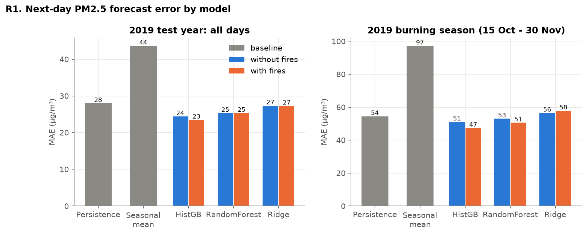
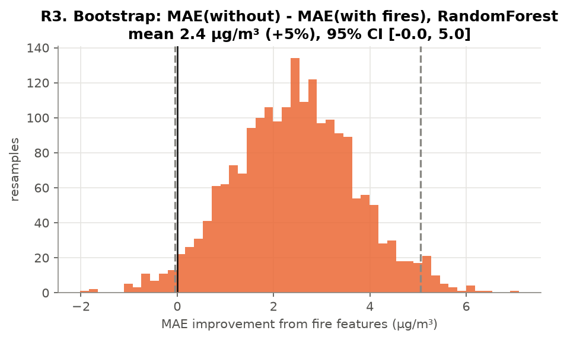
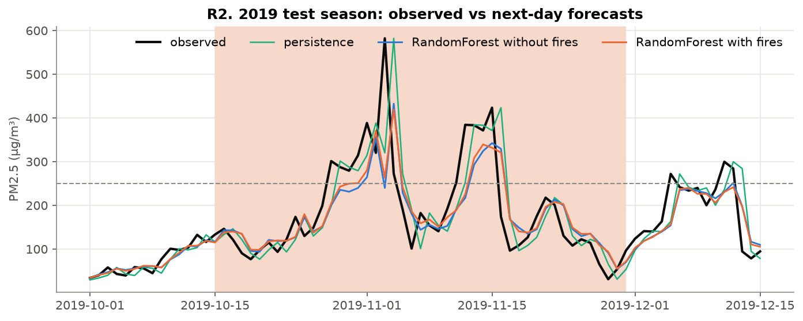
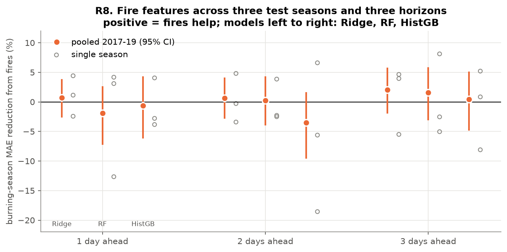
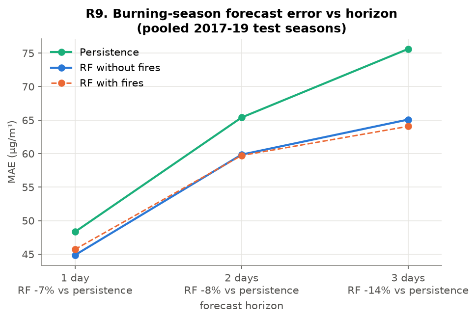
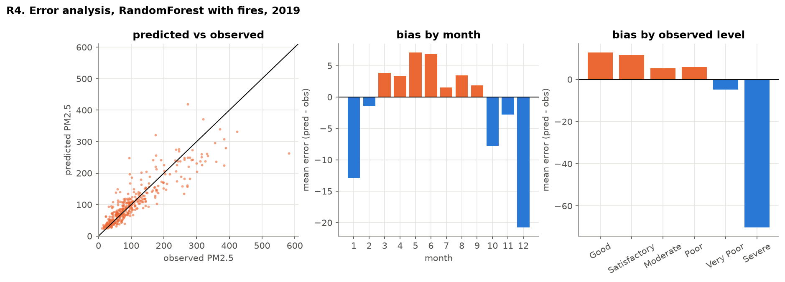
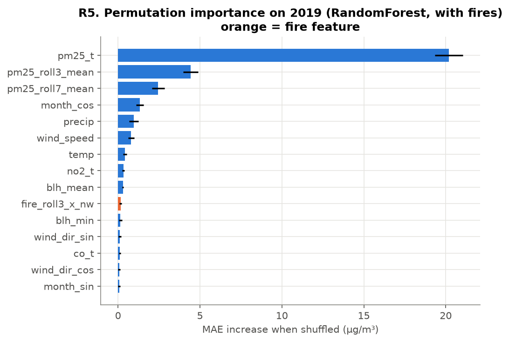
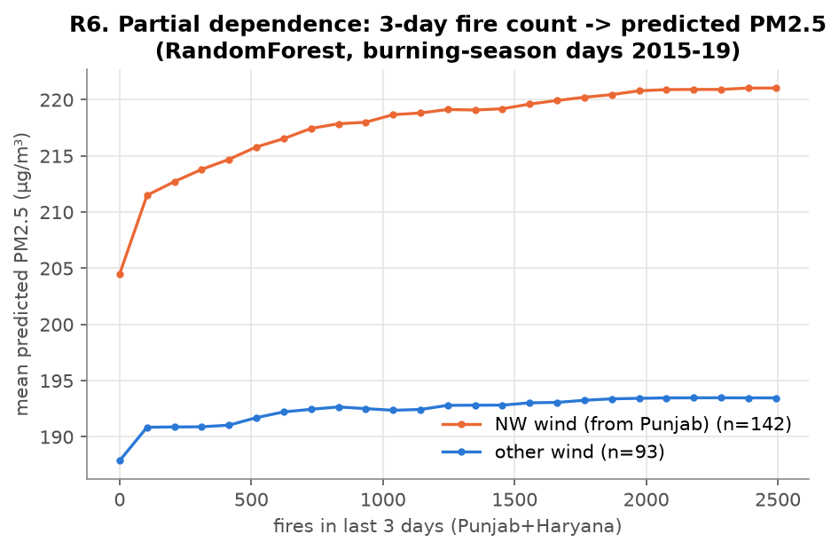

# 1. Problem and motivation

Delhi's PM2.5 regularly exceeds 250 µg/m³ ("Severe") in October–December, more than four times India's 24-hour standard
of 60. Crop-residue burning in Punjab and Haryana is blamed every year, but its contribution is disputed: the same season
brings cold, calm air, a shallow mixing layer, Diwali fireworks, traffic and heating. Authorities act on **next-day**
forecasts (the GRAP restrictions are triggered by AQI levels), so the practical question is predictive:

> **Does adding satellite-detected farm-fire activity in Punjab and Haryana improve next-day prediction of Delhi's PM2.5
> beyond what today's pollution and weather already tell us, and by how much during the burning season?**

The test is an **ablation**. The same model is trained with and without fire features, and the two are compared on a held-out year.
Three measurable goals were fixed in advance, all judged on the 2019 test year:

| ID | Goal | Success criterion |
|----|------|-------------------|
| G1 | Beat the naive forecast | Best model MAE < persistence MAE, overall and in the burning season |
| G2 | Quantify the value of fire data | Burning-season (15 Oct – 30 Nov) MAE ≥ 10% lower with fires; paired-bootstrap 95% CI excluding 0 |
| G3 | Useful for alerts | Recall ≥ 0.7 on Severe days (PM2.5 > 250), with precision reported |

**Summary of findings.** ML forecasts beat persistence by 7–14% in the burning season, with the margin growing from
1-day to 3-day forecasts. In the pre-registered single-season test (2019), fire features appeared to cut burning-season
error by 4.5–7%. A rolling-origin robustness check over three seasons and three horizons shows that this gain does not
generalise: pooled over 141 burning-season days, every fire effect lies between −3.5% and +2.1%, with all 95% CIs including
zero. **Once Delhi's own pollution and weather are known, farm-fire counts add no measurable forecasting skill.**

# 2. Data and justification

| Source | What | Size used | Role |
|--------|------|-----------|------|
| CPCB, via Kaggle `rohanrao/air-quality-data-in-india` (`city_day.csv`, CC0) | Daily city-average pollutants | 2,009 Delhi days, 1 Jan 2015 – 1 Jul 2020 | Target and persistence features |
| NASA FIRMS MODIS C6.1, India yearly files | One row per detected fire pixel (lat, lon, time, confidence, FRP) | 482,420 detections; 119,987 in Punjab+Haryana | Fire features (the tested group) |
| Open-Meteo archive (ERA5 reanalysis), 28.61 N 77.21 E | Daily temperature, humidity, max wind, dominant wind direction, rain; hourly boundary-layer height | 2,009 days, 48k hours | Weather confounders |

* **Source:** CPCB is the official monitoring agency, FIRMS is the standard satellite fire product, and ERA5 is the standard reanalysis. None of it is scraped.
* **Relevance:** the three sources map onto the target, the hypothesised cause and the main confounder.
* **Why weather is essential:** without it, any "fire effect" could just be winter weather. The no-fires model must be strong for the comparison to be fair.
* **MODIS rather than VIIRS:** MODIS gives one consistent sensor across all years.

# 3. Data cleaning

| Issue | Action | Reason |
|-------|--------|--------|
| Duplicate dates | Checked and asserted: none | Lags require one row per day |
| Missing calendar days | Reindexed to a full daily calendar (none were missing) | A lag must mean "yesterday", not "previous row" |
| Missing PM2.5 (2 days, 0.1%) | **Target never imputed**; those rows dropped (2,006 modelling rows remain) | Imputing the target would invent ground truth |
| Feature gaps (PM10 3.8%, SO2/O3 ≈5%) | Forward-fill, max 3 days, on feature copies; remaining NaN → median imputer inside the Pipeline (HGB handles NaN natively) | Uses only past values; interpolation would leak the future |
| Columns > 40% missing | Drop rule (none triggered; Xylene 39% is unused) | Too sparse to be reliable |
| Impossible values (negative, PM > 1,000) | Rule sets them to NaN (0 found) | Sensor errors |
| Extreme but real values (up to 685 µg/m³) | **Kept** | These smog episodes are exactly what we want to predict |
| Non-vegetation / low-confidence fire pixels | Keep `type == 0` and `confidence ≥ 30` (439,543 of 482,420) | Industrial hotspots and false alarms are not crop fires |
| Region | Bounding box 27.6–32.6 N, 73.8–77.6 E (Figure 4) | Captures the burning belt; approximate (limitation) |
| Time zone | UTC acquisition time → IST date (343 detections change day) | Daily features must align with Delhi's calendar |
| Days without detections | 0, not NaN (582 days) | No fire detected is real information |
| Weather gaps | Asserted none | ERA5 is complete |

# 4. Exploratory analysis: key insights

Figure numbers refer to `reports/figures/` and `notebooks/01_eda.ipynb`, where each plot has a fuller discussion.

* **Seasonality (Figs 1, 2):** the monthly median ranges from 43 (Aug) to 210 µg/m³ (Nov–Dec). The burning-window median is 190, against 83 on other days. High levels continue through Dec–Jan, *after* the fires stop, so weather alone produces severe smog.
* **Fires and PM2.5 (Fig 3):** 69% of detections fall in 15 Oct – 30 Nov. A second fire season in April–May (wheat) produces **no** PM2.5 spike, because summer winds and deep mixing disperse the smoke. Fires matter only when the weather lets them.
* **Region (Fig 4):** 92% of Oct–Nov detections in the wider window fall inside the box. A small cluster from western UP also falls inside it.
* **Lags (Fig 5):** within Oct–Nov, the correlation between log fires and PM2.5 *rises* with lag, from 0.27 (same day) to 0.48 (4–5 days). Smoke accumulates over days, which justifies 3- and 7-day rolling fire sums.
* **Weather confounding (Fig 6):** PM2.5 falls with wind speed (Spearman −0.34), mixing height (−0.44), temperature (−0.53) and rain (−0.54).
* **Wind direction (Fig 7):** NW winds (from Punjab) dominate the cool season on *all* days (about 45%). Severe days are not more often NW, so direction alone is not the mechanism. This motivates a fire × NW-wind interaction instead.
* **Correlations (Fig 8):** tomorrow's PM2.5 correlates 0.90 with today's. Fire features correlate 0.44–0.54 with it, but they are also confounded with temperature and season.
* **Diwali (Fig 9):** PM2.5 jumps the day after Diwali (2017: 176 → 427; 2018: 175 → 420), inside the burning season. A Diwali flag is included in *both* model variants so fireworks are not credited to fires.

# 5. Method

## 5.1 Features (built in `src/features.py`)

Row *t* holds what is known by the end of day *t*. The target is PM2.5 on day *t+1*.

| Group | Features |
|-------|----------|
| Persistence | PM2.5 today, lags 1–3, 3- and 7-day means; PM10, NO2, CO today |
| Weather (day *t*) | wind speed, wind direction (sin/cos), NW-wind flag (270–360°), temperature, humidity, rain, boundary-layer height mean and min |
| Calendar (of day *t+1*, known in advance) | month (sin/cos), weekday, Diwali ± 2 days, burning-season flag |
| **Fires (tested)** | count today, lags 1–3, 3- and 7-day sums, log counts, FRP sum, log 3-day sum × NW wind |

We use observed day-*t* weather, not day-*t+1* weather, which would amount to assuming a perfect weather forecast.

## 5.2 Split and leakage control

```
 2015 ── 2016 ── 2017  │  2018  │  2019  │ 2020 H1
 TRAIN (TimeSeriesSplit 5-fold CV)  │  VAL  │  TEST  │ stress test
                        └── refit on 2015–2018 ──┘   (scored once)
```

A random split would leak, because neighbouring days are almost identical. Rows are assigned by the **date predicted**.
Imputation and scaling are inside sklearn Pipelines, so they are fitted on training folds only.
`tests/test_features.py` scrambles every value after a cut-off day and asserts that no feature on or before the cut-off changes.
It also checks that the target *does* change, so the test is shown to catch leakage.

## 5.3 Models

| Model | Why | Tuning (GridSearchCV, TimeSeriesSplit(5), MAE) |
|-------|-----|----------|
| B0 Persistence | Honest baseline; PM2.5 is highly autocorrelated | none |
| B1 Seasonal mean | What the calendar alone explains | none |
| M1 Ridge | Interpretable; L2 handles collinear lags | α ∈ {0.1, 1, 10, 100} → 100 |
| M2 Random Forest | Non-linear effects and interactions (fire × wind) | depth, leaf size, max_features |
| M3 HistGradientBoosting | Strong on tabular data, native NaN handling | learning rate, depth, iterations |

M1–M3 are fitted on log(1 + PM2.5), because the target is right-skewed and errors grow with the level. Predictions are
back-transformed, and all metrics are in µg/m³. **MAE** is the main metric: it is in physical units, and it is robust
to a few extreme days. RMSE (which penalises big misses) and R² are also reported.

**Selection rule (fixed in advance):** choose the model family with the lowest *mean* validation MAE across its two
variants, so the choice does not favour either side of the fire comparison. Random Forest scored 20.60, HistGB 20.67
and Ridge 22.97, so **Random Forest** was selected.

# 6. Results

**Table 1. 2019 test MAE (µg/m³)**, n = 365 overall and 47 burning-season days

| Model | Variant | MAE overall | MAE burning season | R² overall |
|-------|---------|------------:|-------------------:|-----------:|
| Persistence | – | 27.95 | 54.45 | 0.71 |
| Seasonal mean | – | 43.61 | 97.17 | 0.48 |
| Ridge | no fires | 27.31 | 56.43 | 0.72 |
| Ridge | with fires | 27.22 | 57.80 | 0.72 |
| **Random Forest (selected)** | no fires | 25.28 | 52.97 | 0.77 |
| **Random Forest (selected)** | **with fires** | **25.30** | **50.57** | 0.78 |
| HistGB | no fires | 24.36 | 50.99 | 0.78 |
| HistGB | with fires | 23.43 | 47.30 | 0.79 |



**G1 — met.** The selected model beats persistence by 9.5% overall and 7.1% in the burning season. The seasonal mean
is far worse, so yesterday's air matters much more than the calendar. Ridge does not beat persistence in the burning
season. HistGB scored best on test, but we keep the model chosen on validation rather than re-selecting after seeing
the test result.

**Table 2. G2: burning-season gain from fire features** (MAE without − MAE with; positive means fires help)

| Model | Gain (µg/m³) | Gain % | 95% CI, paired bootstrap | 95% CI, 7-day block bootstrap |
|-------|-----:|------:|------:|------:|
| Ridge | −1.37 | −2.4% | [−4.51, 1.94] | [−3.96, 0.96] |
| **Random Forest** | **2.40** | **4.5%** | **[−0.05, 5.05]** | [0.55, 5.32] |
| HistGB | 3.69 | 7.2% | [0.64, 6.89] | [−0.30, 8.35] |



**G2 — not met.** The selected model gains 4.5%, below the 10% target, and its pre-specified CI just touches 0.
Both tree models gain 4.5–7.2% on 2019. Each reaches a CI excluding 0 under one of the two bootstraps, never both.
Ridge gains nothing. On its own this looks like a small positive effect. But the 2018 validation year already
disagreed (HistGB was *worse* with fires: 37.6 vs 36.6), and 47 days is a small sample. Section 6.1 tests whether the
2019 result generalises.



**Table 3. G3: Severe-day alerts** (34 Severe days in 2019)

| Rule | Recall | Precision | Caught / missed / false alarms |
|------|-------:|----------:|------:|
| Persistence (today > 250) | 0.65 | 0.63 | 22 / 12 / 13 |
| RF with fires, forecast > 250 | 0.41 | 0.74 | 14 / 20 / 5 |
| RF with fires, forecast > 225 (threshold chosen on 2018) | **0.74** | 0.66 | 25 / 9 / 13 |
| RF with fires, "Very Poor or worse" (> 120) | 0.84 | 0.87 | 90 / 17 / 13 |

**G3 — not met as specified, met with a calibrated threshold.** The regression shrinks extremes towards the mean, so a
forecast of 250 is rarely reached. Choosing the alert threshold on the validation year to give 70% recall gives 225.
On 2019 that gives recall 0.74 and precision 0.66, better than persistence on both. *This calibrated rule was added
after the first test evaluation; it uses validation data only, but we flag it as a secondary result.*

## 6.1 Robustness: three test seasons × three horizons

The primary test uses one season. To check whether its result generalises, `src/robustness.py` runs a
**rolling-origin evaluation**. Each burning season 2017, 2018 and 2019 is the test set in turn, with the model
re-tuned (TimeSeriesSplit CV) and trained only on earlier years. Pooling gives 141 burning-season test days. The whole
experiment is repeated for forecasts **1, 2 and 3 days ahead**: features still stop at day *t*, and only the target
moves. If fires carried real signal, it should appear across seasons, and more strongly at longer horizons where
today's PM2.5 is less informative. *This analysis was added after the primary result.*

**Table 4. Pooled burning-season gain from fire features (2017–2019, 141 days)**

| Horizon | Model | MAE no fires | MAE with fires | Gain | 95% CI (µg/m³) | Gain 2017 / 2018 / 2019 |
|---|---|---:|---:|---:|---|---|
| 1 day | Ridge | 49.5 | 49.1 | +0.7% | [−1.2, 1.9] | +1.1 / +4.4 / −2.4% |
| 1 day | Random Forest | 44.9 | 45.7 | −1.9% | [−3.0, 1.2] | −12.7 / +3.1 / +4.2% |
| 1 day | HistGB | 45.5 | 45.8 | −0.6% | [−2.6, 2.0] | −3.8 / −2.8 / +4.1% |
| 2 days | Ridge | 60.3 | 59.9 | +0.7% | [−1.6, 2.4] | +4.8 / −3.4 / −0.3% |
| 2 days | Random Forest | 59.9 | 59.7 | +0.2% | [−2.2, 2.6] | −2.3 / −2.5 / +3.9% |
| 2 days | HistGB | 59.8 | 61.9 | −3.5% | [−5.3, 0.9] | −5.6 / −18.6 / +6.6% |
| 3 days | Ridge | 63.4 | 62.1 | +2.1% | [−1.2, 3.6] | +4.6 / −5.5 / +4.0% |
| 3 days | Random Forest | 65.1 | 64.1 | +1.6% | [−1.8, 3.9] | −2.5 / −5.0 / +8.1% |
| 3 days | HistGB | 64.9 | 64.6 | +0.5% | [−3.0, 3.3] | +0.9 / −8.1 / +5.2% |

Persistence burning-season MAE: 48.3 (1 day), 65.4 (2 days), 75.6 (3 days).



* **The 2019 gain does not generalise.** In 2019, fires help every tree model at every horizon. In 2017 and 2018 they often hurt, by up to 19%. Single-season results range from −19% to +8%. The pooled estimates sit near zero, and **every 95% CI includes zero** (Table 4, Fig R8). The 2019 estimate is within this season-to-season spread.
* **No hidden longer-horizon effect.** At 3 days, gains are +0.5% to +2.1%, all with CIs including zero.
* The 7-day block bootstrap gives the same conclusion (see `reports/metrics/robustness_summary.json`).



* **The models' value grows with the horizon** (Fig R9). Random Forest beats persistence by 7% at 1 day, 8% at 2 days and 14% at 3 days in the burning season. Weather and seasonal context matter more as yesterday's value becomes less informative. With-fires and without-fires lie on top of each other at every horizon.

# 7. Error analysis and interpretation



* **Shrinkage:** bias is +12 µg/m³ on Good days and −70 on Severe days (Fig R4). This is the classic regression-to-the-mean pattern, and it explains the low recall at the fixed 250 threshold.
* **Season:** the largest under-prediction is in Dec–Jan, which is winter-inversion smog with no fires that the model cannot fully explain.
* **Wind:** MAE is 31.7 on NW-wind days vs 18.5 on other days, because NW days are mostly in the polluted season.
* **Worst 10 days:** all fall in Nov–Jan. The worst, 3 Nov 2019 (582 observed vs 263 forecast), came in the 2019 public-health-emergency episode. Fire detections fell to 8 and 26 on 2–3 Nov, then jumped to 1,886 on 4 Nov: smoke and haze probably hid the fires from the satellite exactly when they mattered. Several large *over*-predictions (4 and 16 Nov, 14 Jan) are sudden clean-ups the day after a peak. No Diwali day is among the worst, so the Diwali flag works.
* **Lag:** forecasts follow the observed series with about a one-day lag (Fig R2). The models mainly improve on persistence by not over-shooting after a peak collapses.



**Permutation importance (Fig R5):** today's PM2.5 dominates (+20 µg/m³ when shuffled), followed by the 3- and 7-day means, season, rain and wind.
Individual fire features look negligible because the ten of them stand in for each other. Shuffling the **whole fire
group at once** raises burning-season MAE by 3.2 µg/m³, which agrees with the ablation (2.4).



**Partial dependence (Fig R6):** the forecast rises with recent fire counts, by about **+17 µg/m³ with NW wind against
+6 with other winds**. The pattern is physically plausible (transport from Punjab), but Section 6.1 shows it does not
translate into a reliable forecast improvement. It is the model's internal response, not evidence of an effect. Ridge (Fig R7) gives `log_fire_roll3_sum` the 7th-largest standardised coefficient.

**Stress test (2020 H1, COVID lockdown, no burning season):** the tree models beat persistence (MAE 17.1–17.3 vs 19.7),
and the with/without-fires variants are identical, as they should be.

# 8. Limitations and bias

1. **Predictive, not causal.** "Fire counts add no forecasting skill" does **not** mean fires do not pollute Delhi. Their smoke is already reflected in Delhi's PM2.5 and in the seasonal weather the models use. Measuring how much fires *cause* needs chemical-transport or source-apportionment modelling.
2. **Satellite detection.** MODIS overpasses are around 10:30 and 13:30 local time, but burning has shifted to evenings. Smoke and cloud hide fires (3 Nov 2019 is an example), and small fires are missed. Counts are only a proxy.
3. **Region:** the bounding box is not a state polygon and includes part of western UP.
4. **Spatial averaging:** city-average PM2.5 hides station differences, and the weather is one grid point.
5. **Few seasons:** the primary test has 47 burning-season days. The robustness check raises this to 141, but that is still only three seasons, and season-to-season variation is large (Table 4).
6. **Observed rather than forecast weather:** an operational system would use NWP forecasts for *t+1*.
7. **Post-hoc steps:** the calibrated alert threshold and the robustness analysis were added after the first test run. Both are reported alongside the primary results, not instead of them.
8. **Data age:** the data ends in mid-2020, and burning practices and policy have changed since then.

# 9. Conclusion and next steps

The ML models beat persistence (G1), and their advantage grows with the forecast horizon, from 7% at 1 day to 14% at
3 days in the burning season (Fig R9). On the pre-registered single test season (2019), fire features appeared to help by
4.5–7% (G2 not met). A rolling-origin check across three seasons and three horizons shows that this does not
generalise: pooled gains range from −3.5% to +2.1%, and every CI includes zero (Table 4). For Severe-day alerts, a
validation-calibrated threshold reaches 74% recall at 66% precision (Table 3).

**Answer:** once Delhi's own PM2.5 and weather are known, satellite fire counts from Punjab and Haryana add **no
measurable skill** to 1–3-day PM2.5 forecasts. This does not mean the fires are harmless. It means their effect is already
visible in the variables a forecaster has, so counting fires adds nothing new. The project also shows a methodological
point: a single-season test produced a plausible 5–7% "effect" that disappeared when tested on more seasons.

**Next steps:** more seasons (CPCB 2021–2025) to tighten the CIs; VIIRS 375 m fires (better at small and evening
fires); HYSPLIT back-trajectories to count only fires whose air actually reaches Delhi; forecast rather than observed
weather; extreme-aware losses to reduce the shrinkage on Severe days.

# Appendix: viva preparation

* **Why not split randomly?** Consecutive days are nearly identical, so a random split puts "tomorrow" into training and inflates scores. Time order mimics real forecasting.
* **Why MAE?** It is in µg/m³, easy to explain, and not dominated by a handful of 500+ days. RMSE is reported for big misses.
* **Why a log target?** PM2.5 is right-skewed and its errors scale with level. The log stabilises variance. Metrics are computed after back-transforming.
* **How do you know there is no leakage?** Every feature is past-only by construction, preprocessing is inside Pipelines, and the unit test scrambles the future and proves no past feature changes. The test year was scored once with a selection rule fixed in advance.
* **Does this prove fires cause smog?** No. It shows that fire counts add predictive information beyond persistence and weather. Attribution needs physical modelling.
* **Why keep the outliers?** They are real smog episodes and the reason for the project. Only physically impossible values would be removed.
* **What if the CI includes 0?** It did, and we then tested on more seasons rather than arguing about one. With 141 days and three horizons, every CI includes 0, so we conclude there is no measurable added skill, not that fires are proven irrelevant.
* **Isn't the robustness check post-hoc?** Yes, and it is labelled as such. It was run to *challenge* a positive result, not to rescue a negative one, and it trains each fold only on earlier years. The primary 2019 analysis is still reported in full.
* **So do fires matter?** For air quality, very likely. For *forecasting* given today's PM2.5 and weather, the counts add nothing new. Those are different questions.
